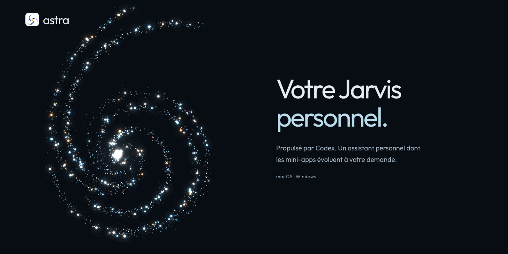
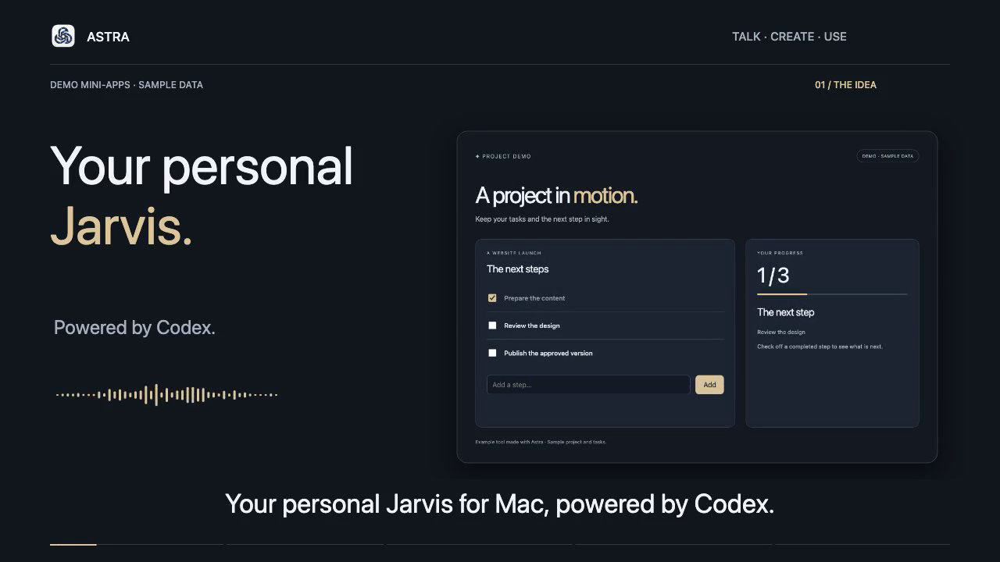

<p align="center"></p>

<p align="center"><a href="README.md">English</a> · <strong>Français</strong></p>
<p align="center">Un assistant vocal pour macOS, Windows et Linux, avec des mini-apps que vous créez et faites évoluer par la conversation.</p>
<p align="center"><a href="https://getastra.halcytron.chatgpt.site/?lang=fr">Site web</a> · <a href="#installation">Installer</a> · <a href="#découvrir-astra">Voir la démo</a> · <a href="CONTRIBUTING.md">Contribuer</a></p>

## Installation

Nécessite [Codex CLI](https://developers.openai.com/codex/cli/) et une connexion ChatGPT.

### macOS et Linux

```sh
curl -fsSL https://getastra.halcytron.chatgpt.site/install.sh | bash
```

**macOS :** Apple Silicon, macOS 14 ou ultérieur. Autorisez les accès macOS nécessaires au premier lancement. Les premières versions sont signées localement, sans notarisation Apple.

**Linux :** Debian/Ubuntu sur x64 ou ARM64, avec APT.

[Télécharger directement](https://github.com/witong42/Astra/releases) · [Lire le script d’installation](install.sh)

Pour une installation manuelle sur Linux, téléchargez le **`.deb` x64 ou ARM64** adapté à votre système depuis les [versions](https://github.com/witong42/Astra/releases) et installez-le avec votre gestionnaire de paquets.

### Windows

Dans PowerShell :

```powershell
irm https://getastra.halcytron.chatgpt.site/install.ps1 | iex
```

[Lire le script PowerShell](install.ps1).

Téléchargez le **ZIP Windows x64** depuis les [versions](https://github.com/witong42/Astra/releases), décompressez toute l’archive, puis lancez **`Install.cmd`**. Retrouvez ensuite Astra dans le menu Démarrer.

Les premières versions Windows ne sont pas signées.

## Découvrir Astra

[](.github/assets/astra-demo-en.mp4)

Demandez à Astra un tableau de bord pour votre journée, puis utilisez sa liste de tâches et son minuteur. [Voir la démo](.github/assets/astra-demo-en.mp4).

- **Parlez naturellement.** Discutez avec Astra, ou écrivez quand vous préférez.
- **Créez vos mini-apps.** Un suivi de projet, un programme de voyage, un quiz, ou le petit outil dont vous avez besoin.
- **Faites-les évoluer en demandant.** Un bouton en plus, une vue plus simple, une autre façon de travailler : Codex adapte l’app avec vous.
- **Retrouvez vos outils.** Rouvrez les apps sauvegardées et utilisez leurs commandes locales.
- **Continuez sur votre téléphone.** En option, reliez-le à votre ordinateur, allumé et connecté à votre réseau privé.

Essayez : **« Crée une mini-app pour suivre mon projet et ses prochaines étapes. »** Puis : **« Ajoute une vue plus simple pour me concentrer. »**

## Accès et données

Astra donne actuellement à Codex un **accès complet aux fichiers et aux commandes de votre ordinateur, sans confirmation**. Les mini-apps s’affichent dans des cadres isolés ; cela ne limite pas les outils système de Codex.

Stockage local par défaut :

| Plateforme | Apps et journal | Fichiers créés |
| --- | --- | --- |
| macOS | `~/Library/Application Support/Astra/` | `~/.astra/` |
| Windows | `%APPDATA%\Astra\` | `%USERPROFILE%\.astra\` |
| Linux | `$XDG_CONFIG_HOME/Astra/` ou `~/.config/Astra/` | `~/.astra/` |

Les requêtes passent par votre fournisseur Codex. Votre authentification existante reste en place. La voix dépend d’interfaces expérimentales de Codex, susceptibles de changer selon sa version.

<details>
<summary>Compiler depuis les sources</summary>

Installez [Bun](https://bun.sh/docs/installation) et Codex CLI, puis connectez-vous à Codex. Sur macOS, installez Homebrew, les outils en ligne de commande Apple et les outils de compilation du moteur vocal :

```sh
brew install autoconf automake libtool
```

Sur Windows, utilisez Bun x64 et Docker Desktop avec les conteneurs Linux pour compiler le moteur vocal. Pour compiler sur Linux, installez `autoconf`, `automake`, `g++`, `make`, `libtool`, `gfortran`, `pkg-config`, `libopenblas-pthread-dev` et `liblapacke-dev`, puis sélectionnez l’entrée pkg-config OpenBLAS pthread. Ces dépendances servent à la compilation ; le `.deb` contient le moteur vocal.

Puis, sur une plateforme prise en charge :

```sh
git clone https://github.com/witong42/Astra.git
cd Astra
bun install --frozen-lockfile
bun start
```

Pour la voix en temps réel, utilisez la [distribution officielle complète de Codex](https://github.com/openai/codex/releases/latest/download/install.sh), avec ses ressources vocales. Le chemin de l’exécutable peut être indiqué avec ASTRA_CODEX_PATH.

</details>

## Accès téléphone

La configuration téléphone est documentée et testée sur macOS : reliez le Mac et le téléphone par Tailscale. Le Mac doit rester allumé, avec Astra ouverte. Le site de présentation public ne donne aucun accès à votre instance personnelle. [Configuration détaillée en anglais](README.md#phone-access).

## Contribuer

Testez Astra sur macOS, Windows ou Linux, signalez un problème reproductible ou proposez un changement ciblé. Consultez [CONTRIBUTING.md](CONTRIBUTING.md). Ne partagez jamais votre authentification, votre journal privé ou un fichier de sauvegarde complet.

Astra est un projet indépendant, sans affiliation avec OpenAI. Code original sous [licence MIT](LICENSE). Les licences tierces et les [crédits Solar Icons / 480 Design](THIRD_PARTY_NOTICES.md) sont conservés.
