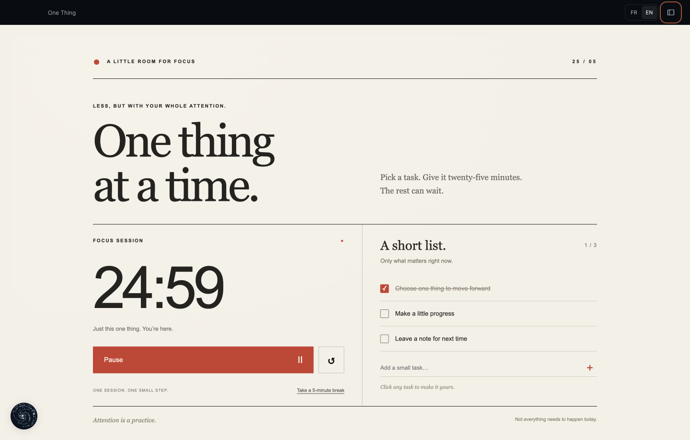

<p align="center">
  
</p>

<h1 align="center">Astra</h1>
<p align="center"><strong>Talk an idea into a tool.</strong></p>
<p align="center">A personal assistant for your Mac that turns conversations into little apps you can keep using.</p>
<p align="center">
  <a href="#try-astra">Try Astra</a> ·
  <a href="#what-can-you-make">What can you make?</a> ·
  <a href="#phone-access">Use your phone</a> ·
  <a href="https://github.com/witong42/Astra/issues">Feedback</a>
</p>



<p align="center"><em>Made from one typed request. <a href=".github/assets/demo.mp4">Watch the real creation</a> · <a href=".github/assets/demo.gif">GIF</a>. The generation wait is shortened; the timer and checkboxes work locally.</em></p>

Ask for a focus timer. Turn a messy idea into a planner. Make a tiny quiz for something you're learning. Then change it by asking again.

Astra gives those conversations a home: a library of mini-apps, a voice assistant, and a journal. It runs on your Mac through your existing Codex CLI. You can also connect your phone to that same Mac.

**Early and experimental.** Start with the source build below. Tested on Apple Silicon, macOS 26.2, Bun 1.4.3 and Codex CLI 0.164.0. Other setups need testing; voice depends on experimental Codex interfaces and may break with a CLI update.

## What can you make?

| Ask Astra for… | Keep using… |
| --- | --- |
| “Build a focus timer with a short task list.” | A timer with working controls and checkboxes |
| “Make a revision quiz for this topic.” | A personal study app |
| “Help me plan my week.” | A planner you can edit directly |
| “Add a notes area to this.” | An updated version of the same app |

- **Speak or type.** Talk with Astra or open a mini-app's chat to build and change it.
- **Keep your tools.** Reopen saved apps, edit their controls, rename them and mark favorites.
- **Bring context together.** A central assistant and journal connect your work across mini-apps.
- **Choose French or English.** The interface language is set separately on each device.
- **Use your own Codex session.** ChatGPT sign-in works through Codex; Astra adds no separate AI subscription. Your plan's Codex limits still apply.

Generated apps can make mistakes. The examples above are prompts to try; they aren't a bundled app store.

## Try Astra

You'll need a Mac, [Bun](https://bun.sh/docs/installation), Apple's Command Line Tools and a working [Codex CLI](https://developers.openai.com/codex/cli/).

1. Install the Command Line Tools if you don't already have them:

   ```sh
   xcode-select --install
   ```

2. Sign in to Codex with your ChatGPT account and check that it works:

   ```sh
   codex login
   codex login status
   codex --version
   ```

3. Build and open Astra:

   ```sh
   git clone https://github.com/witong42/Astra.git
   cd Astra
   bun install --frozen-lockfile
   bun start
   ```

4. Click **EN** for English, create a mini-app, and try:

   > Build a 25-minute focus timer with a short task list. Warm paper, black ink and a tomato-red accent. Make the timer and checkboxes work.

For voice, use the microphone control and grant macOS microphone and speech-recognition access. Use the complete Codex distribution provided by its [official standalone installer](https://github.com/openai/codex/releases/latest/download/install.sh), rather than a single copied binary. The tested distribution includes `codex-resources/voice/bin/codex-voice-host` beside its `bin` directory. A CLI installation without those resources can still support typed requests, but won't provide Astra's realtime voice transport.

If Astra can't find Codex, launch it with the executable path explicitly:

```sh
CODEXOS_CODEX_PATH="$(command -v codex)" bun start
```

You can create a local application bundle with `bun run package`. It appears under `release/v<version>/Astra.app`. Builds are locally signed, without Apple notarization; building from source is the supported first step. Don't replace a running app bundle.

## Access and data

**Astra currently gives Codex full filesystem and command access on your Mac, without approval prompts.** Use it on a machine and with files you're comfortable letting an agent change. The mini-app iframe is isolated from the host interface, but it is not a security boundary around Codex's system tools or requested Mac automation.

- App state, saved interfaces and journal: `~/Library/Application Support/CodexOS/`. The historical folder name is intentional.
- Default folder for files Astra creates: `~/.astra/`.
- Codex authentication and configuration stay in your existing Codex installation.
- Model requests go through Codex and its configured provider. Local storage does not mean local model inference.
- Remote phone access is off until you configure it. Your Mac must remain awake and Astra must remain running.

An independent project by [witong42](https://github.com/witong42), unaffiliated with OpenAI. Astra doesn't include or redistribute Codex, a ChatGPT subscription, or model access.

## Phone access

This is an optional setup for your own devices. Astra's web client connects to the same Mac backend over your private Tailscale network; it doesn't move the agent to the cloud.

1. Install [Tailscale](https://tailscale.com/kb/1017/install) on the Mac and phone. Enable HTTPS for your tailnet.
2. Choose a private HTTPS origin for the static web client, such as `https://astra.example.com`. Keep it private to you. A public static client does not authenticate users to your Mac.
3. Create `~/Library/Application Support/CodexOS/remote-access.json` with your actual frontend origin and Tailscale login:

   ```json
   {
     "origin": "https://astra.example.com",
     "user": "you@example.com",
     "port": 4319
   }
   ```

   Protect the file with `chmod 600`, then restart Astra. The backend binds to loopback.
4. Serve that backend through Tailscale on an unused HTTPS port. For example:

   ```sh
   tailscale serve --bg --https=8443 http://127.0.0.1:4319
   ```

5. Build the static client against your Mac's exact Tailscale HTTPS origin:

   ```sh
   ASTRA_REMOTE_URL=https://your-mac.your-tailnet.ts.net:8443 bun run build:web
   ```

6. Privately host `dist/client/` at the frontend origin chosen above. If using ChatGPT Sites, configure your own project locally; the generated `dist/server/index.js` preserves the HTML headers that Astra's sandbox needs. Personal hosting manifests are ignored by Git.

Open the frontend on your phone while connected to Tailscale. The configured Tailscale identity and frontend origin are checked by the Mac backend. Don't expose its loopback port directly to the internet. Audio permission and playback support vary by mobile browser; Android Brave has been tested on the maintainer's setup.

## Contribute

The most useful first contribution is trying Astra on another Mac and reporting what happened. Include macOS, chip, Bun and Codex versions, a short reproduction and redacted errors. Never attach your Codex authentication, private journal or whole saved workspace.

[Report a bug](https://github.com/witong42/Astra/issues/new?template=bug_report.yml) · [Suggest an improvement](https://github.com/witong42/Astra/issues/new?template=feature_request.yml) · [Contributor guide](CONTRIBUTING.md)

```sh
bun run check
bun test
bun run build
ASTRA_REMOTE_URL=https://astra-backend.example.com bun run build:web
```

Runtime: Bun. Desktop: Electron + React + TypeScript. Formatting and linting: Biome. Generated interfaces support HTML canvases, OpenUI and JSON-render.

## License and credits

Astra's original code is [MIT licensed](LICENSE). Third-party components retain their own licenses; see [Third-party notices](THIRD_PARTY_NOTICES.md).

Built with [Codex](https://github.com/openai/codex), [Electron](https://www.electronjs.org/), [Bun](https://bun.sh/), [React](https://react.dev/), [OpenUI](https://github.com/thesysdev/openui), and [json-render](https://github.com/vercel-labs/json-render). [Solar Icons by 480 Design](https://www.figma.com/community/file/1166831539721848736) are used under [CC BY 4.0](https://creativecommons.org/licenses/by/4.0/), through the MIT-licensed [Solar React package](https://github.com/saoudi-h/solar-icons). [Phosphor Icons](https://phosphoricons.com/) are MIT licensed. Icons are rendered with changes to size and color.
