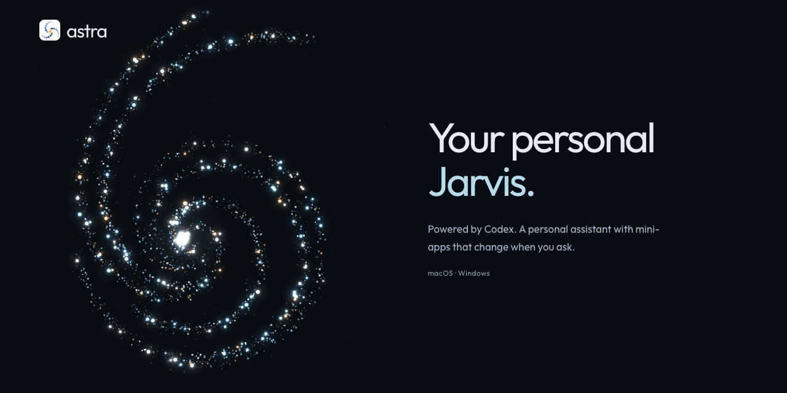

<p align="center"></p>

<p align="center"><strong>English</strong> · <a href="README.fr.md">Français</a></p>
<p align="center">A voice-first assistant for macOS, Windows and Linux, with mini-apps you can build and reshape through conversation.</p>
<p align="center"><a href="https://getastra.halcytron.chatgpt.site">Website</a> · <a href="#installation">Install</a> · <a href="#meet-astra">Watch the demo</a> · <a href="CONTRIBUTING.md">Contribute</a></p>

## Installation

Requires [Codex CLI](https://developers.openai.com/codex/cli/) with ChatGPT sign-in.

### macOS and Linux

```sh
curl -fsSL https://getastra.halcytron.chatgpt.site/install.sh | bash
```

**macOS:** Apple Silicon, macOS 14 or later. First launch requires the usual macOS permissions. Early builds are locally signed and are not Apple notarized.

**Linux:** Debian/Ubuntu on x64 or ARM64, with APT.

[Download manually](https://github.com/witong42/Astra/releases) · [Read the installer](install.sh)

For a manual macOS installation, open the **macOS `.dmg`** from [Releases](https://github.com/witong42/Astra/releases) and drag **Astra** into **Applications**.

For a manual Linux installation, download the **x64 or ARM64 `.deb`** matching your system from [Releases](https://github.com/witong42/Astra/releases) and install it with your package manager.

### Windows

Run in PowerShell:

```powershell
irm https://getastra.halcytron.chatgpt.site/install.ps1 | iex
```

[Read the PowerShell installer](install.ps1).

Download the **Windows x64 ZIP** from [Releases](https://github.com/witong42/Astra/releases), extract the complete archive, then run **`Install.cmd`**. Open Astra from the Start menu after installation.

Early Windows builds are not code-signed.

## Meet Astra

[](.github/assets/astra-demo-en.mp4)

Ask Astra to create a daily dashboard, then use its task list and focus timer. [Watch the demo](.github/assets/astra-demo-en.mp4).

- **Talk naturally.** Speak with Astra or type when you prefer.
- **Make your own mini-apps.** A project tracker, a trip planner, a quiz, or the small tool you need.
- **Change them by asking.** Add a button, simplify a view, reshape a workflow. Codex updates the app with you.
- **Keep using them.** Reopen saved apps, use their local controls, and keep your work in one place.
- **Pick up from your phone.** Optionally connect to your desktop through your private network while it stays on.

Try: **“Make a mini-app to track my project and its next steps.”** Then: **“Add a simpler view so I can focus.”**

## Access and data

Astra currently gives Codex **full file and command access on your computer without approval prompts**. Generated mini-apps run in isolated frames; this does not restrict Codex's system tools.

Default local storage:

| Platform | App state and journal | Created files |
| --- | --- | --- |
| macOS | `~/Library/Application Support/Astra/` | `~/.astra/` |
| Windows | `%APPDATA%\Astra\` | `%USERPROFILE%\.astra\` |
| Linux | `$XDG_CONFIG_HOME/Astra/` or `~/.config/Astra/` | `~/.astra/` |

Model requests use your configured Codex provider. Your existing Codex authentication stays in place. Voice uses experimental Codex interfaces and is version-sensitive.

<details>
<summary>Build from source</summary>

Install [Bun](https://bun.sh/docs/installation) and Codex CLI, then sign in with Codex. On macOS, install Homebrew, Apple Command Line Tools and the native voice build tools:

```sh
brew install autoconf automake libtool
```

On Windows, use x64 Bun and Docker Desktop with Linux containers for the native voice build. Linux source builds require `autoconf`, `automake`, `g++`, `make`, `libtool`, `gfortran`, `pkg-config`, `libopenblas-pthread-dev` and `liblapacke-dev`, with the pthread OpenBLAS pkg-config entry selected. These are build dependencies; the `.deb` includes the voice runtime.

Then, on any supported platform:

```sh
git clone https://github.com/witong42/Astra.git
cd Astra
bun install --frozen-lockfile
bun start
```

For realtime voice, use the complete [official Codex distribution](https://github.com/openai/codex/releases/latest/download/install.sh), including its voice resources. Use ASTRA_CODEX_PATH if your executable is installed elsewhere.

</details>

## Phone access

<details>
<summary>Optional private phone setup on macOS</summary>

This is an optional setup for your own devices. Astra's web client connects to the same Mac backend over your private Tailscale network; it doesn't move the agent to the cloud.

1. Install [Tailscale](https://tailscale.com/kb/1017/install) on the Mac and phone. Enable HTTPS for your tailnet.
2. Choose a private HTTPS origin for the static web client, such as `https://astra.example.com`. Keep it private to you. A public static client does not authenticate users to your Mac.
3. Create `~/Library/Application Support/Astra/remote-access.json` with your actual frontend origin and Tailscale login:

   ```json
   {
     "origin": "https://astra.example.com",
     "user": "you@example.com",
     "port": 4319
   }
   ```

   Protect the file with `chmod 600`, then restart Astra. The backend binds to loopback.
4. Serve that backend through Tailscale on an unused HTTPS port. For example:

   ```sh
   tailscale serve --bg --https=8443 http://127.0.0.1:4319
   ```

5. Build the static client against your Mac's exact Tailscale HTTPS origin:

   ```sh
   ASTRA_REMOTE_URL=https://your-mac.your-tailnet.ts.net:8443 bun run build:web
   ```

6. Privately host `dist/client/` at the frontend origin chosen above. If using ChatGPT Sites, configure your own project locally; the generated `dist/server/index.js` preserves the HTML headers that Astra's sandbox needs. Personal hosting manifests are ignored by Git.

Open the frontend on your phone while connected to Tailscale. The configured Tailscale identity and frontend origin are checked by the Mac backend. Don't expose its loopback port directly to the internet. Audio permission and playback support vary by mobile browser; Android Brave has been tested on the maintainer's setup.

</details>

## Contributing

Try Astra on macOS, Windows or Linux, report a reproducible issue, or propose a focused change. See [CONTRIBUTING.md](CONTRIBUTING.md). Never upload authentication, your private journal or a whole saved workspace.

Astra is an independent project, unaffiliated with OpenAI. Original code: [MIT](LICENSE). Third-party licenses and [Solar Icons / 480 Design attribution](THIRD_PARTY_NOTICES.md) are preserved.
